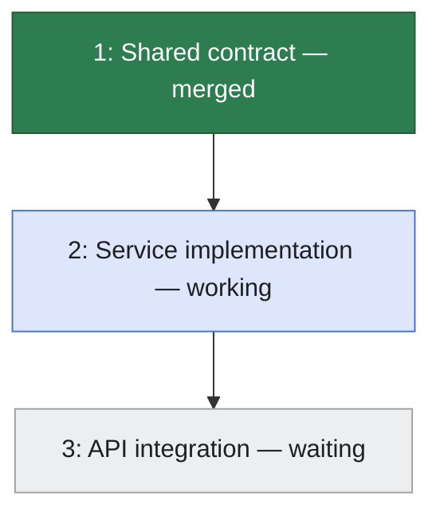

# Mermaid diagrams in Markdown

Use a fenced `mermaid` block in Markdown for both the plan's task graph and the
live `.sail/<plan-slug>/ship-log-dag.md`. No Excalidraw file, extension, renderer,
or Python script is required. The underlying Markdown remains readable even
when a viewer does not render Mermaid.

Derive nodes and edges from the plan's task IDs and `Blocked by` fields. Every
task appears once, including completed or dropped tasks. An arrow points from
prerequisite to dependent. Use stable node identifiers such as `task_1` and
`task_2a`, and quoted, short labels. Escape characters that would break Mermaid
syntax; keep full titles, links, and details in the adjacent Markdown table.

````markdown
# <Plan name>: task status

Updated: <timestamp with timezone>



| Task | State | PR | Dependency |
|---|---|---|---|
| 1 | Merged | <PR link> | — |
| 2 | Working | — | Task 1 |
| 3 | Waiting | — | Task 2 |
````

Use `waiting` for queued tasks/unfinished dependencies; `active` for working,
evaluation, or fixes; `pending` for running CI; `green` for passed
CI; `merged` only after GitHub confirms merge; `blocked` for failed checks or
external decisions; and `dropped` for removed scope. Keep textual state labels
so color is not the only signal. PRs in the ordinary branch sequence remain
green, not merged, until GitHub confirms a merge. Track the PR sequence and base
branches in the ship log separately from the graph's code dependencies.

When dependencies or tasks change, update the plan and live diagram together.
Recheck unique IDs, known edge endpoints, acyclicity, and agreement with task
fields. Preserve existing task IDs and status; never reset a resumed run's
state merely to regenerate the graph. A static plan graph can use neutral
labels, while the run diagram reflects observed state.
